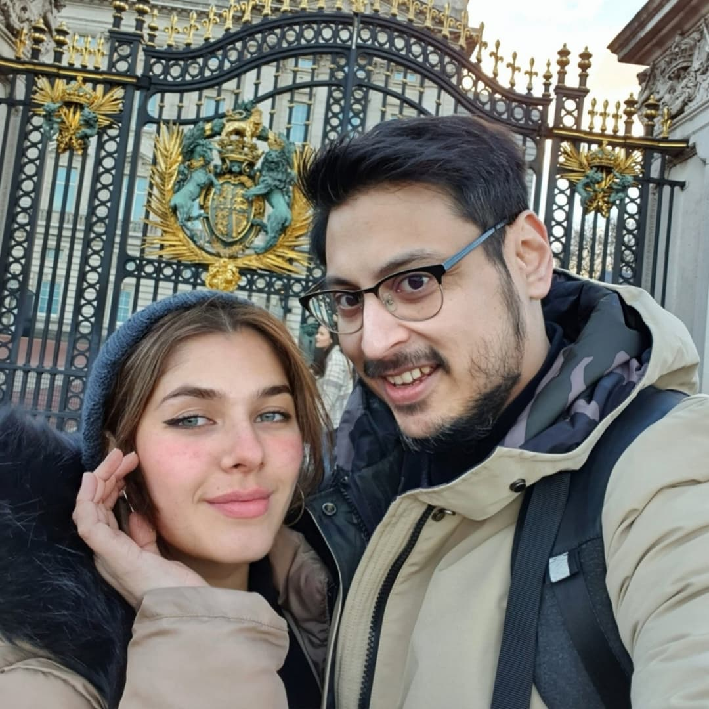
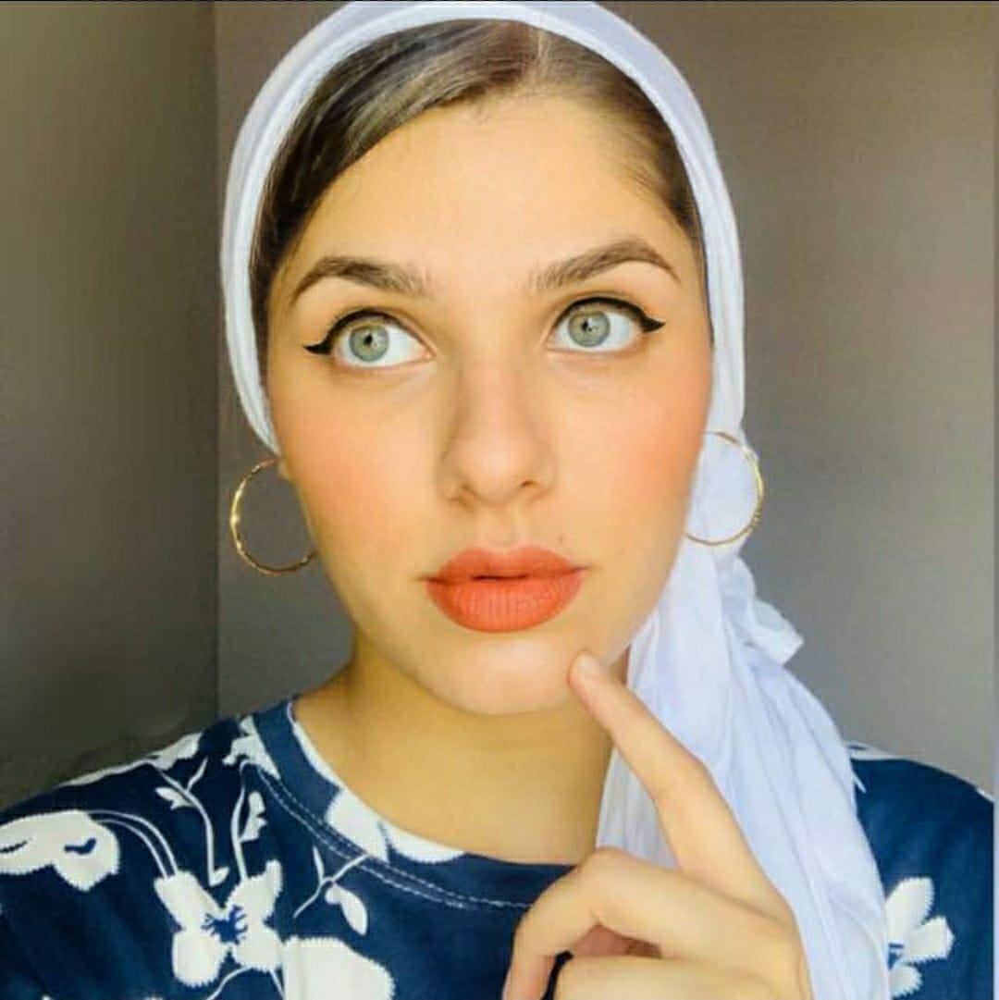
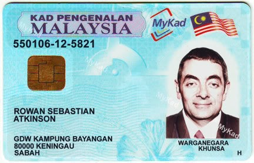
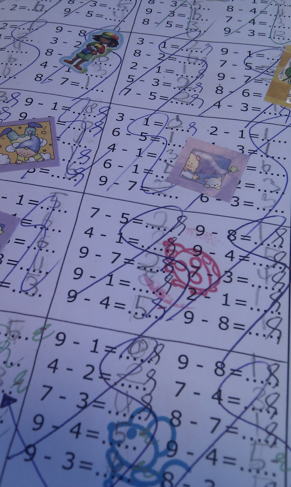

# Results

All tests ran on 7–8 November 2026, on the machine listed in the [README](../README.md).

> **Read this first.** My card was held back by its driver ("SW Power Cap") at about **187 W**, even though the limit was set to 370 W. The graphics clock sat around 390–615 MHz instead of 1,000+ MHz. Changing to two separate power cables didn't fix it. So these are the numbers of a **capped** RTX 3090. Because the card never went above ~187 W, I only tested at 370 W — a 250 W run would have given the same numbers. See [issues.md](issues.md).

Every number below is a median unless it says otherwise. "TTFT" is time to first token: how long you wait before the answer starts. Raw data for every single request is in [`results/`](../results/).

---

## Before vs After

**Before** = HyperQwen with its speed trick switched off (`SPEC=off`, no speculative decoding). **After** = HyperQwen's normal fast mode (DFlash2). Everything else is identical: the same model, the same card, the same capped ~187 W, and the same prompts and settings. After ran on 7–8 November 2026, Before on 8 November 2026. Medians, in tokens per second.

| Test | Before | After | Faster by |
|---|---:|---:|---:|
| Chat, thinking off | 18.37 | 50.55 | 2.8× |
| Chat, thinking low | 18.37 | 53.58 | 2.9× |
| Chat, thinking medium | 18.36 | 47.57 | 2.6× |
| Chat, thinking xhigh | 18.36 | 52.03 | 2.8× |
| 15 minutes non-stop | 18.38 (36 answers) | 48.73 (105 answers) | 2.7× |
| Copy the document | 16.57 | 176.24 | **10.6×** |
| Summarise the document | 16.50 | 38.27 | 2.3× |
| Image: selfie (off / xhigh) | 19.04 / 18.41 | 44.99 / 41.66 | 2.4× / 2.3× |
| Image: portrait (off / xhigh) | 18.39 / 18.46 | 44.45 / 41.85 | 2.4× / 2.3× |
| Image: ID card (off / xhigh) | 18.45 / 18.45 | 48.37 / 50.45 | 2.6× / 2.7× |
| Image: worksheet (off / xhigh) | 18.34 / 18.27 | 60.98 / 44.41 | 3.3× / 2.4× |

GPU in both: about 186–187 W, 59–60 °C max, graphics clock 390–420 MHz. Zero failed requests in both.

**What it means:** without the trick, this card writes about 18 tokens a second no matter what you ask. HyperQwen's trick makes it about **2.5–3× faster** for normal work, and **over 10× faster** when the answer copies text it has already seen. That's on a card running at half power.

## 1. Chat (text only)

Five everyday prompts (explain a fridge to a 12-year-old, a Python palindrome function with tests, the 2008 financial crisis in five bullets, an English-to-Malay translation, a one-day workshop agenda). Each prompt × each thinking mode × 2 repeats. Max 4,096 tokens.

| Thinking mode | Requests | Speed (tok/s) median / min / max | TTFT (s) median / min / max |
|---|---:|---|---|
| off | 10 | **50.55** / 25.12 / 98.05 | 0.163 / 0.134 / 0.190 |
| low | 10 | **53.58** / 42.66 / 78.74 | 0.169 / 0.080 / 0.452 |
| medium | 10 | **47.57** / 40.33 / 82.21 | 0.162 / 0.140 / 0.343 |
| xhigh | 10 | **52.03** / 44.00 / 64.34 | 0.244 / 0.238 / 0.653 |

GPU during this block: started at 42 °C, max 60 °C, median 186.2 W, graphics clock 405 MHz, memory clock 9,501 MHz.

**What it means:** the thinking level hardly changes the speed. It changes how much the model writes before answering. (Before, with the trick off: 18.4 tok/s for every mode.)

## 2. Fifteen minutes non-stop

Same prompts on a loop, thinking off, max 1,024 tokens, one request after another for 900 seconds. 105 requests.

| | First 2 minutes | Last 2 minutes |
|---|---:|---:|
| Speed | 50.62 tok/s | 46.45 tok/s |
| Power | 187.20 W | 186.75 W |
| Temperature (median / max) | 57 / 58 °C | 59 / 59 °C |
| Graphics clock | 420 MHz | 390 MHz |

Overall median: **48.73 tok/s**, TTFT 0.150 s. It stayed steady and cool. (Before, with the trick off: 18.38 tok/s, only 36 answers in the same 15 minutes.)

## 3. Copy the document

This is where HyperQwen's trick shines. The model gets a ~25,000-token document (built from HyperQwen's own docs, [`results/copy_document.txt`](../results/copy_document.txt)) and is asked to write out the first 60 lines word for word. Because the answer copies the input, almost every guess from the helper model is right. As a control, the same document is summarised in five bullet points. HyperQwen's copy mode (`DFLASH_TOKENS=15`), thinking off, temperature 0, 3 repeats each.

| Task | Speed (tok/s) median / min / max | TTFT (s) |
|---|---|---|
| Copy first 60 lines | **176.24** / 174.31 / 178.46 | 0.932 |
| Summarise (control) | **38.27** / 38.15 / 38.37 | 0.953 |

Copying was **about 4.6× faster** than summarising. With the trick off, both ran at the same speed (16.57 vs 16.50 tok/s) — so this whole gap is HyperQwen's doing.

Two honest notes:
- The TTFT under 1 second is because the document was already cached from a warm-up run. It is not how long it takes to read 25,000 tokens from scratch.
- All three copy answers hit the 2,048-token limit, so they were cut off. The speed figure is still valid.

## 4. Images

HyperQwen switched to image mode (`VISION=1`). Four photos, each with thinking off and xhigh, 2 repeats each, max 4,096 tokens. I wrote down the correct answers **before** running anything, and I never asked the model who anyone is.

### Speed

| Image | Thinking | Speed (tok/s) median | TTFT (s) median | Prompt tokens |
|---|---|---:|---:|---:|
| Selfie at the gates | off | 44.99 | 2.000 | 1,202 |
| Selfie at the gates | xhigh | 41.66 | 1.780 | 1,242 |
| Portrait | off | 44.45 | 1.716 | 1,193 |
| Portrait | xhigh | 41.85 | 1.813 | 1,233 |
| ID card | off | 48.37 | 0.474 | 175 |
| ID card | xhigh | 50.45 | 0.417 | 215 |
| Maths worksheet | off | 60.98 | 4.102 | 2,079 |
| Maths worksheet | xhigh | 44.41 | 3.252 | 2,119 |

GPU: started at 49 °C, max 60 °C, median 186.9 W, graphics clock 405 MHz.

### How it did

#### Image 1 — my wife and me at the palace gates

**Prompt:** *"Describe this photo in detail: the people, their clothing, the setting and anything notable in the background. Where do you think it was taken, and why?"*

**Correct answer:** two people taking a selfie in winter clothes, in front of black and gold gates with the UK royal coat of arms (lion and unicorn). This is Buckingham Palace in London.

**Result: people right, place wrong — every time.** It described both of us, the clothes, the scarf, the backpack strap and the gold coat of arms well. But it named the wrong place in all 4 runs: **Paris (Les Invalides)** twice, **Madrid (Royal Palace)** once and **Edinburgh (Holyroodhouse)** once. The Edinburgh run did recognise the UK royal coat of arms with its lion and unicorn, then picked the wrong palace. None said Buckingham Palace.

#### Image 2 — portrait

**Prompt:** *"Describe this photo in detail: the person's appearance, clothing, accessories, makeup, pose, expression and background."*

**Result: excellent.** White headscarf, thin gold hoop earrings, black winged eyeliner, light green eyes, orange lipstick, finger on the chin in a thinking pose, navy top with white flowers, plain grey background. All correct. The only slip: it said her lips were "slightly parted".

#### Image 3 — ID card (a fake I made)

**Prompt:** *"Read every piece of text on this card exactly as written. Then say what kind of document it is and explain what the long number encodes, if you know the format."*

**Correct answer:** a Malaysian MyKad. Text: `KAD PENGENALAN MALAYSIA`, `MyKad`, `550106-12-5821`, `ROWAN SEBASTIAN ATKINSON`, `GDW KAMPUNG BAYANGAN`, `80000 KENINGAU`, `SABAH`, `WARGANEGARA KHUNSA`, `H`. In the number, `550106` is the date of birth (6 January 1955), `12` is the place-of-birth code for **Sabah**, and the last four digits are a serial number ([Wikipedia](https://en.wikipedia.org/wiki/Malaysian_identity_card)).

**Result: mixed.**
- With thinking **on** (best run), it copied every line of text perfectly, called the card a parody, and even noticed the birth date matches the pictured actor's real birthday. But it said code `12` is **Kuala Lumpur**. Wrong: it's Sabah.
- The other thinking-on run used up all 4,096 tokens and was cut off mid-answer.
- With thinking **off**, it didn't copy the text as asked. One run misread "KHUNSA" and invented the meaning "Indonesian Citizen", and said `12` is **Penang**. The other run gave a two-line answer.

#### Image 4 — a child's maths worksheet

**Prompt:** *"This is a child's maths worksheet. List every printed sum you can read with its correct answer. Then describe what is handwritten, drawn or stuck on top of the worksheet."*

**Result: good maths, made-up marking, and thinking mode failed.**
- Thinking **off**: it recognised single-digit subtraction and listed 52–53 sums. I checked them with a script, and **every answer was correct**. Both runs noticed the stickers and scribbles (one also the stamps). But both runs invented tick-and-cross "grading marks" that aren't on the page, and some sticker descriptions were off.
- Thinking **xhigh**: both runs spent all 4,096 tokens thinking and **gave no answer at all**.

### Right or wrong changes from run to run

I ran the same four images again with the trick off (the "Before" runs). The trick isn't supposed to change the answers, only the speed. But some answers came out differently:

- In one "Before" run it **got the palace right**: Buckingham Palace, London, because it recognised the UK royal coat of arms. The other Before runs said Paris and Madrid, and one ran out of tokens.
- In one "Before" run it said **code 12 = Sabah** (correct). Another called it a Selangor code (wrong).
- The worksheet sums were again all correct (50 and 54 listed, 0 wrong), the made-up tick marks came back, and thinking mode ran out of tokens again.

With only two tries per image, right or wrong is partly luck. Don't trust a single answer on facts.

### What I take from the image tests

- Describing people and details: very good.
- Facts that need knowledge (which palace, what a code means): unreliable. It sounds confident even when it's wrong.
- Thinking mode needs a much bigger token allowance for hard images. 4,096 cut off 3 of the 8 thinking runs. That part of my test wasn't fair to the model.

## 5. What I didn't test

- **250 W vs 370 W:** pointless while the card is capped at ~187 W.
- **Video:** the model understands video, but HyperQwen doesn't document it. With only about 1.2 GB of GPU memory spare with images on, I expect it to run out of memory, so I skipped it.
- **Many users at once (batch mode):** I only care about one user.
